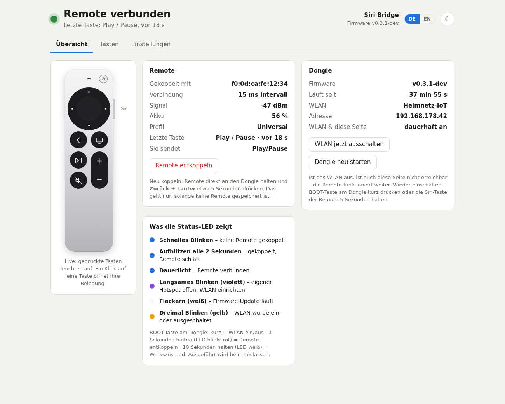
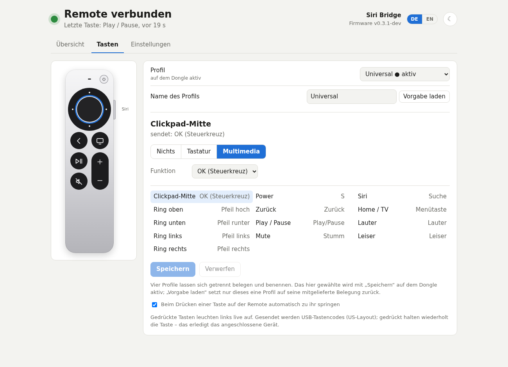
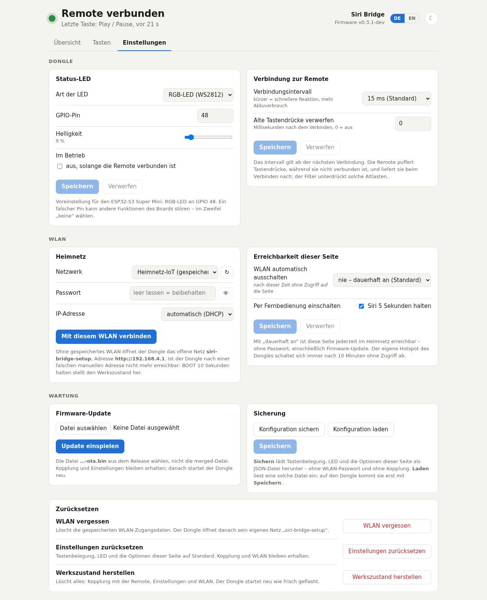

# Siri Remote ESP32 Bridge

🇩🇪 Deutsch · [🇬🇧 English](README.en.md)

Ein ESP32-S3 für ein paar Euro, der die **Apple Siri Remote (3. Generation, USB-C)** per Bluetooth
koppelt und sich am Mediaplayer als ganz gewöhnliche **USB-Tastatur** ausgibt. Gedacht für **Kodi** auf
**CoreELEC** oder **LibreELEC**, funktioniert aber überall, wo eine Tastatur funktioniert.

Kurz: ein „Flirc für die Siri Remote“. Apple verkauft dafür lieber ein Apple TV.



## Warum es das gibt

Die Siri Remote ist die vielleicht angenehmste Fernbedienung, die man kaufen kann, und sie redet mit
exakt einem Gerät auf diesem Planeten. Per Infrarot kann sie Lautstärke und Power, alles andere geht
über Bluetooth LE in einem Dialekt, den Android, Fire OS und Windows höflich ignorieren.

Der Dongle spricht diesen Dialekt und übersetzt ihn in das Einzige, was wirklich jedes Gerät seit
1996 versteht: Tastendrücke.

## Was er kann

- Koppelt die Remote von selbst, sobald man sie im Pairing-Modus danebenhält
- Alle 13 Tasten als USB-Tastatur oder Multimedia-Taste, frei belegbar
- Vier Belegungsprofile zum Umschalten und Umbenennen, drei davon vorbelegt
- Reaktion ohne spürbare Verzögerung, Gedrückthalten wiederholt (das erledigt der Mediaplayer)
- Weboberfläche mit Live-Anzeige der Tastendrücke, Akkustand der Remote, hell und dunkel
- Firmware-Update über die Weboberfläche, mit automatischem Rückfall, falls das Update Unsinn war
- Status-LED, die tatsächlich etwas bedeutet
- Sicherung und Wiederherstellung der Konfiguration als JSON-Datei

## Was er nicht kann

- **Touchpad-Wischen.** Die Remote schickt die Daten, wir werten bisher nur die Klicks aus. Steht ganz
  oben auf der Wunschliste.
- **Siri.** Das Mikrofon wird nicht abonniert. Niemand hört zu. Versprochen.
- **Fire TV.** Sollte gehen, ist aber ungetestet; siehe [Wunschliste](#wunschliste).
- **Passwörter.** Dazu weiter unten mehr.

## Womit es getestet ist

Ehrlicherweise: mit genau einem Aufbau.

| Teil | Getestet mit | Anmerkung |
|---|---|---|
| Board | ESP32-S3 Super Mini (4 MB Flash, 2 MB PSRAM) | Andere ESP32-S3-Boards mit nativem USB-Port gehen vermutlich auch; die LED sitzt dann woanders (einstellbar). |
| Remote | Siri Remote 3. Generation, Modell A2854 (USB-C) | Ältere Generationen sprechen ein anderes Protokoll. |
| Mediaplayer | Kodi auf CoreELEC | Alles, was eine USB-Tastatur annimmt, sollte gehen. |
| Kabel | USB-C | Eines, das Daten kann. Ja, das muss man dazusagen. |

Wer es mit etwas anderem ausprobiert: Rückmeldungen sind willkommen, in beide Richtungen.

## Installieren

**Der bequeme Weg:** ESP per USB an den Rechner, in Chrome oder Edge den
[Browser-Installer](https://technohoschi.github.io/siri-remote-esp32-bridge/) öffnen, „Installieren“
klicken.

**Der händische Weg:** Unter [Releases](../../releases) die Datei `siri_bridge-…-merged.bin` laden und
mit [esptool-js](https://espressif.github.io/esptool-js/) oder `esptool` an Adresse `0x0` flashen.

Geht der ESP nicht von selbst in den Flash-Modus: BOOT halten, RESET tippen, BOOT loslassen.

Beide Wege überschreiben alles, auch Kopplung und Einstellungen. Für spätere Updates nimmt man deshalb
die `…-ota.bin` und die Weboberfläche.

## Erste Schritte

1. Dongle an den Mediaplayer stecken. Die LED blinkt schnell: Er sucht eine Remote.
2. Remote direkt an den Dongle halten und **Zurück + Lauter** etwa fünf Sekunden drücken.
3. Die LED leuchtet dauerhaft. Fertig. Das war die ganze Einrichtung.

Ist die Remote noch mit einem Apple TV gekoppelt, dieses vorher ausschalten. Sie kann nur eine
Beziehung gleichzeitig führen.

### Die Status-LED

| LED | Bedeutung |
|---|---|
| Schnelles Blinken (blau) | Keine Remote gekoppelt |
| Aufblitzen alle 2 Sekunden (blau) | Gekoppelt, die Remote schläft und meldet sich beim nächsten Tastendruck |
| Dauerlicht (blau) | Verbunden |
| Langsames Blinken (violett) | Eigener Hotspot offen: WLAN einrichten |
| Flackern (weiß) | Firmware-Update läuft, Finger weg vom Stecker |
| Dreimal Blinken (gelb) | WLAN wurde gerade ein- oder ausgeschaltet |

Wem Dauerlicht hinter dem Fernseher zu viel Lightshow ist: In den Einstellungen lässt sich die LED im
verbundenen Zustand ausschalten.

### Belegung und Profile

Der Dongle bringt vier Profile mit, zwischen denen man in der Weboberfläche umschaltet. Jedes lässt sich
umbelegen und umbenennen.

| Remote | Universal (Standard) | Kodi (CoreELEC) | Android / Fire TV |
|---|---|---|---|
| Ring oben / rechts / unten / links | Pfeiltasten | Pfeiltasten | Pfeiltasten |
| Clickpad-Mitte | Multimedia „OK“ | Enter | Multimedia „OK“ |
| Zurück | Multimedia „Zurück“ | Backspace | Multimedia „Zurück“ |
| Home/TV | Menütaste | C (Kontextmenü) | Multimedia „Home“ |
| Play/Pause | Multimedia „Play/Pause“ | Leertaste | Multimedia „Play/Pause“ |
| Power | S (Shutdown-Menü in Kodi) | S | nichts |
| Lauter / Leiser / Mute | Multimedia-Tasten | Multimedia-Tasten | Multimedia-Tasten |
| Siri | Multimedia „Suche“ | nichts | Multimedia „Suche“ |

Das vierte Profil, „Eigenes Profil“, ist eine Kopie von „Universal“ zum Verbasteln.

„Universal“ ist bei einer Fernbedienung abgeschaut, die über einen Flirc-Dongle an Fire TV und CoreELEC
gleichermaßen funktioniert: Menütaste und Multimedia-„Zurück“. Die Clickpad-Mitte sendet dort die
OK-Taste einer Fernbedienung statt Enter, weil Android mit Enter in einem Suchfeld keine Bildschirmtastatur
öffnet. Die Siri-Taste sendet „Suche“: Das öffnet in Apps wie YouTube die Suche, auf dem Startbildschirm
des Fire TV passiert nichts. Eine Sprachsuche lässt sich dort per USB-Taste nicht auslösen; „Sprachassistent“
steht für andere Android-Geräte trotzdem zur Auswahl. Wer selbst so ein bewährtes Gespann hat,
kann mit `tools/key_scan.py` nachsehen, was es sendet. „Universal“ ist an einer CoreELEC-Box und einem
Fire TV erprobt; „Android / Fire TV“ ist bisher ungetestet.

**Zur Lautstärke, mit Vorsicht:** Lauter, Leiser und Mute sendet die Remote zusätzlich selbst per
Infrarot, mit den Codes, die sie einmal an einem Apple TV für den Fernseher gelernt hat. Bei uns hat das
nach dem Koppeln mit dem Dongle meistens weiter funktioniert, zwischendurch aber auch einmal nicht – warum,
wissen wir nicht. Reagiert der Fernseher mit, regeln er und der Mediaplayer gemeinsam; wen das stört, der
stellt die drei Tasten im Profil auf „Nichts“.

## Die Weboberfläche

Beim ersten Start öffnet der Dongle ein eigenes Netz namens `siri-bridge-setup`. Verbinden, die Seite
geht von selbst auf (sonst `http://192.168.4.1`), Heimnetz auswählen, Passwort eintragen. Danach hängt
er im Heimnetz und bleibt dort erreichbar. Findet er es nicht, kommt der Hotspot nach etwa 15 Sekunden
zurück. Der Hotspot selbst schaltet sich nach zehn Minuten ohne Zugriff ab.

Ein kurzer Druck auf **BOOT** am Dongle oder fünf Sekunden auf der **Siri-Taste** schalten das WLAN
aus und wieder ein; die LED quittiert das mit dreimal Gelb. Endlich hat die Siri-Taste eine Aufgabe.
Wer das WLAN nicht dauerhaft laufen lassen will, stellt in den Einstellungen eine Abschaltzeit ein.
Auch eine feste IP-Adresse lässt sich dort vergeben.

Die BOOT-Taste kann noch mehr, jeweils beim Loslassen:

| BOOT halten | LED dabei | Wirkung |
|---|---|---|
| kurz | – | WLAN ein/aus |
| 3 Sekunden | blinkt rot | Remote entkoppeln |
| 10 Sekunden | weiß | Werkszustand: Kopplung, Einstellungen und WLAN weg |

Die letzte Stufe ist der Notausgang, falls man sich mit einer falschen IP-Adresse ausgesperrt hat.



Unter **Tasten** klickt man auf der gezeichneten Remote eine Taste an und legt fest, was sie sendet.
Wer die echte Remote in der Hand hat, drückt einfach die Taste; die Seite springt hin.



Unter **Einstellungen** finden sich LED, Verbindung, WLAN, Firmware-Update, Sicherung und drei Stufen
von „alles zurück“: WLAN vergessen, Einstellungen zurücksetzen, Werkszustand.

Die Oberfläche spricht bisher nur Deutsch. Eine Sprachumschaltung steht auf der Wunschliste.

### Zum Thema Passwort

Es gibt keins. Weder für den Hotspot noch für die Weboberfläche. Das ist Absicht.

Das Ding ist eine Fernbedienungs-Brücke, kein Tresor. Wer im selben Netz sitzt, kann die
Lautstärketaste umbelegen oder eine andere Firmware einspielen. Wer das im eigenen Wohnzimmer für ein
realistisches Szenario hält, stellt „WLAN automatisch ausschalten“ auf ein paar Minuten, dann ist die
Weboberfläche nur noch auf Knopfdruck da. Alle anderen lassen die Kirche im Dorf.

## Update und Rückfall

Firmware-Updates kommen als `…-ota.bin` über die Weboberfläche. Kopplung und Einstellungen bleiben
erhalten.

Stürzt eine neue Firmware in den ersten 15 Sekunden ab, startet der Bootloader beim nächsten Versuch
wieder die vorige Version. Diese Funktion existiert, weil eine frühere Version beim Start abstürzte
und der Dongle sich danach am USB nicht mehr meldete. Man lernt.

Falls doch einmal gar nichts mehr geht: `tools/esp_rescue.py` fängt den ESP in dem Augenblick nach dem
Einstecken ab, in dem er noch ansprechbar ist. Auch das ist aus Erfahrung entstanden.

## Selbst bauen

Entwickelt wird auf einem Raspberry Pi 5, an dem der ESP per USB hängt. Praktisch: Der Pi sieht den
ESP als Tastatur und kann so die ganze Kette prüfen.

```bash
firmware/build.sh siri_bridge          # bauen, Images landen in firmware/dist/
firmware/build.sh siri_bridge upload   # bauen und flashen
python3 tools/ui_dev.py                # Weboberfläche ohne ESP, mit Beispieldaten, Port 8766
```

Gebraucht werden `arduino-cli`, der ESP32-Core 3.3.12 und die Bibliothek NimBLE-Arduino 2.5.1. Der
Core belegt rund 8 GB. Für eine Fernbedienung.

Bei jedem Versions-Tag baut GitHub Actions die Images, hängt sie an das Release und aktualisiert den
Browser-Installer.

| Wo | Was |
|---|---|
| `firmware/siri_bridge/` | Firmware: BLE, USB-HID, Weboberfläche, Einstellungen |
| `firmware/siri_bridge/web/index.html` | Die Weboberfläche, eine einzige Datei |
| `tools/ui_dev.py` | Entwicklungsserver für die Weboberfläche |
| `tools/serial_log.py`, `tools/hid_watch.py` | Serial-Log des ESP und seine USB-Tastendrücke unter Linux mitlesen |
| `tools/key_scan.py` | Zeigt, was ein anderes USB-Eingabegerät sendet, etwa ein Flirc |
| `tools/esp_rescue.py` | Holt einen ESP aus der Boot-Schleife |
| `tools/linux/` | Die Remote direkt an einem Linux-Rechner mitlesen (aus der Erkundungsphase, braucht BlueZ und `bleak`) |
| `docs/PROTOCOL.md` | Was wir über das Protokoll der Remote herausgefunden haben (englisch) |

## Was unter der Haube anders ist als überall beschrieben

Für alle, die sich mit dieser Remote schon einmal die Zähne ausgebissen haben:

- **Kein Enable-Write nötig.** Nach Bonding und Abonnieren kommen die Reports von selbst.
- **Die Verbindungsparameter sind der Knackpunkt.** Die Remote will 7,5–15 ms Intervall, Latency 80
  und 6 s Timeout. Mit Standardwerten reißt die Verbindung alle paar Sekunden ab.
- **Zwei Arten, sich zu melden.** Im Pairing-Modus mit erkennbarem Fingerprint, nach dem Aufwachen
  anonym. Wiedererkennen geht nur über die per IRK aufgelöste Adresse.
- **Sie puffert Tastendrücke**, solange sie nicht verbunden ist, und liefert sie danach nach.
- **Das BlueZ-Plugin heißt `hog`**, nicht `hogp`, und `DisablePlugins` in der `main.conf` gibt es nicht.

Die Details stehen in [docs/PROTOCOL.md](docs/PROTOCOL.md).

## Wunschliste

- [ ] **Touchpad:** Wischen als Pfeiltasten, wie am Apple TV
- [ ] **Fire TV Cube** und andere Android-Geräte testen, die Profile danach nachschärfen
- [ ] **Langer Tastendruck** als zweite Belegung
- [ ] **Infrarot senden** als Belegungsart, etwa für die Lautstärke des Fernsehers (braucht eine IR-Diode am Dongle)
- [ ] **Infrarot empfangen:** nebenbei auch gewöhnliche IR-Fernbedienungen übersetzen, der Dongle als besserer Flirc
- [ ] **Sprache der Weboberfläche umschaltbar**
- [ ] Handy-Ansicht der Weboberfläche ordentlich durchtesten

## Dank

Ohne die Vorarbeit dieser Projekte hätte das deutlich länger gedauert:

- [azais-corentin/siri-remote](https://github.com/azais-corentin/siri-remote) – Protokoll der 3. Generation
- [Yanndroid/SiriRemote-Linux](https://github.com/Yanndroid/SiriRemote-Linux) (Branch `gen-3`) – die Tasten-Bitmaske
- [zanneth/siriremote](https://code.zanneth.com/zanneth/siriremote) – Linux-Client
- [h2zero/NimBLE-Arduino](https://github.com/h2zero/NimBLE-Arduino) – der BLE-Stack

Entstanden an zwei Tagen im Dialog mit Claude Code, das den ESP dabei einmal in eine Boot-Schleife
geschickt und ihn anschließend wieder herausgeholt hat.

## Lizenz

[MIT No Attribution](LICENSE): Mach damit, was du willst, auch ohne uns zu erwähnen. Die fertigen
Firmware-Images enthalten außerdem den ESP32-Arduino-Core (LGPL-2.1) und NimBLE-Arduino (Apache-2.0),
für die deren Lizenzen gelten.

Apple, Siri und Apple TV sind Marken von Apple Inc. Dieses Projekt hat mit Apple nichts zu tun, außer
dass es eine ihrer Fernbedienungen ziemlich mag.
